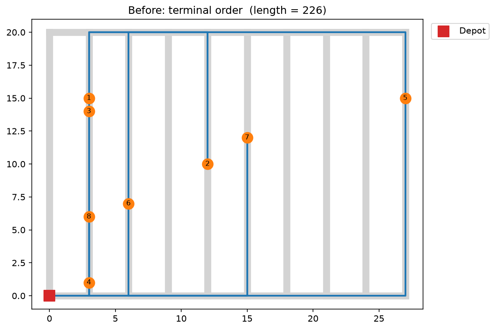
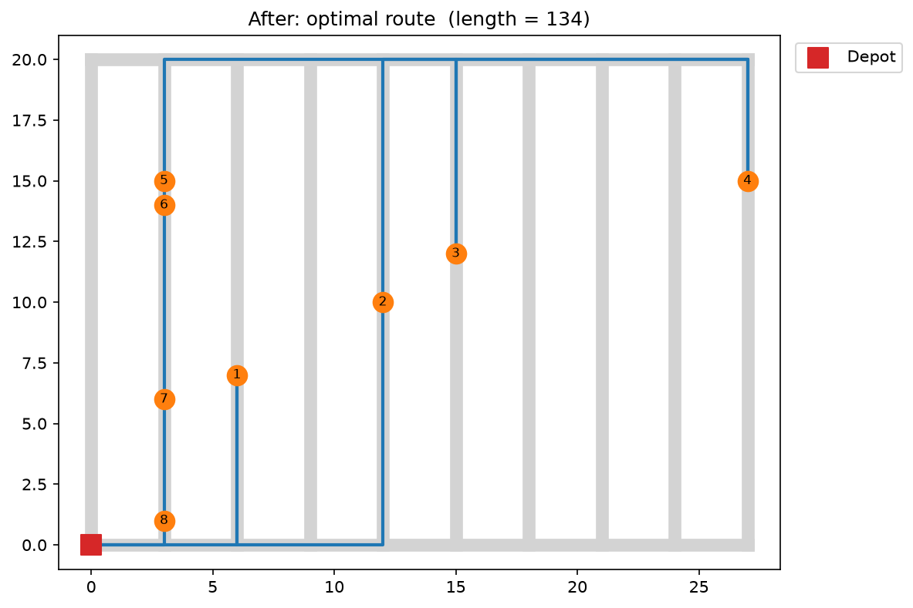
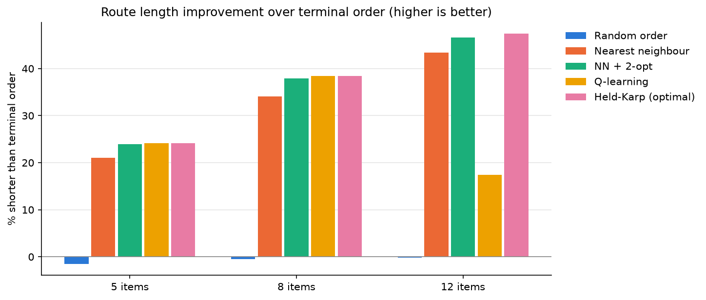
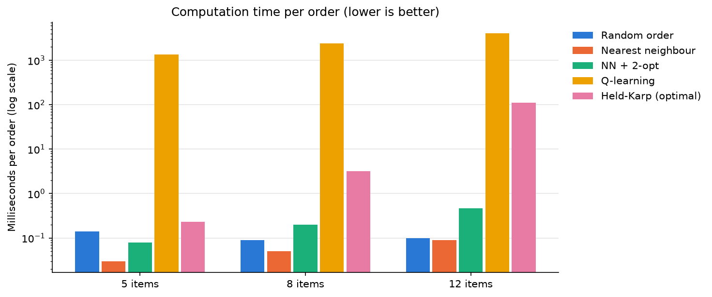
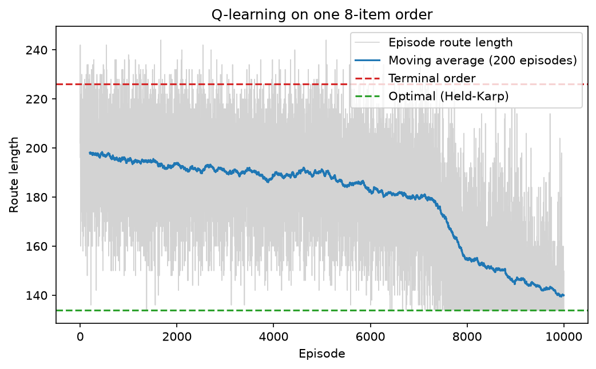

# Pick Route Optimizer

Benchmarking reinforcement learning against classic algorithms for warehouse order-picking routes, in a synthetic warehouse simulation.

## Why this project

I used to work as a picker in a quick-commerce dark store. Orders showed up on the handheld terminal in an order that had nothing to do with where the products were: walk to the far right of the warehouse, then the far left, then right again. Back then I trained a small reinforcement learning model in MATLAB that took the shuffled item list and returned a faster picking sequence.

This repository rebuilds that idea in Python. It also asks a question I skipped the first time: **is RL actually the right tool here, compared with classic routing algorithms?**

> Everything here is synthetic and parametric. No real warehouse layout or data from my former employer is used.

## The problem

Order picking routing is a version of the Travelling Salesman Problem. The picker starts at the depot, visits every item in the order once, and returns.

The warehouse is a rectangle of parallel aisles with one cross aisle at the bottom and one at the top. Walking distance follows the aisles, not a straight line. To move between aisles, the picker has to go around through the shorter of the two cross aisles:

```python
def dist(a, b):
    (x1, y1), (x2, y2) = a, b
    if x1 == x2:                                  # same aisle
        return abs(y1 - y2)
    return abs(x1 - x2) + min(y1 + y2, 2*H - y1 - y2)   # via bottom or top
```

Default layout: 10 aisles, aisle length 20, 190 storage slots. Product IDs are assigned to slots at random (seeded), so the order in which the terminal lists them carries no information about location.

| Before: terminal order (length 226) | After: optimal route (length 134) |
|---|---|
|  |  |

Same 8-item order, picked in terminal order vs. the optimal sequence: **41% less walking**.

## Methods

All solvers share one interface, `solve(start, items, dist) -> route`, so the benchmark runs them on exactly the same orders.

| Method | File | Idea |
|---|---|---|
| Terminal order | `src/solvers/baseline.py` | Pick items in the order they arrive (the baseline to beat) |
| Random order | `src/solvers/baseline.py` | Sanity check: a random sequence |
| Nearest neighbour | `src/solvers/heuristics.py` | Always walk to the closest unpicked item |
| NN + 2-opt | `src/solvers/heuristics.py` | Start from nearest neighbour, then keep reversing route segments while that shortens the tour |
| Held-Karp | `src/solvers/exact.py` | Dynamic programming over subsets; provably optimal, O(2ⁿ·n²) |
| Tabular Q-learning | `src/solvers/rl_qlearning.py` | State = (current position, set of picked items), action = next unpicked item, reward = −distance. Trained from scratch for each order (10,000 episodes, ε-greedy) |

Held-Karp is checked against brute force (every permutation) on small orders to confirm it returns the true optimum.

## Results

200 random orders per size (seed 42), all methods on the same orders. Timings are from a single CPU core on my desktop and will differ on other machines. Route lengths are deterministic.

| Items | Method | Mean route length | Shorter than terminal order | Gap to optimal | Time / order |
|---:|---|---:|---:|---:|---:|
| 5 | Terminal order | 138.7 | 0.0% | 31.8% | 0.02 ms |
| 5 | Nearest neighbour | 109.6 | 21.0% | 4.1% | 0.03 ms |
| 5 | NN + 2-opt | 105.5 | 23.9% | 0.3% | 0.08 ms |
| 5 | Q-learning | 105.2 | 24.1% | 0.0% | 1361.21 ms |
| 5 | Held-Karp (optimal) | 105.2 | 24.1% | 0.0% | 0.23 ms |
| 8 | Terminal order | 209.0 | 0.0% | 62.3% | 0.01 ms |
| 8 | Nearest neighbour | 137.7 | 34.1% | 6.9% | 0.05 ms |
| 8 | NN + 2-opt | 129.9 | 37.9% | 0.8% | 0.20 ms |
| 8 | Q-learning | 128.8 | 38.4% | 0.0% | 2401.15 ms |
| 8 | Held-Karp (optimal) | 128.8 | 38.4% | 0.0% | 3.23 ms |
| 12 | Terminal order | 301.0 | 0.0% | 90.0% | 0.02 ms |
| 12 | Nearest neighbour | 170.5 | 43.4% | 7.6% | 0.09 ms |
| 12 | NN + 2-opt | 160.7 | 46.6% | 1.5% | 0.47 ms |
| 12 | Q-learning | 248.7 | 17.4% | 57.0% | 4035.70 ms |
| 12 | Held-Karp (optimal) | 158.4 | 47.4% | 0.0% | 111.81 ms |

The full table, including the random-order baseline, is in [`results/benchmark.md`](results/benchmark.md).





### Q-learning on a single order



The moving average falls from about the terminal-order level towards the optimum. It doesn't fully reach the green line because the agent still explores 5% of the time at the end of training. The final greedy route is optimal.

## What the results say

1. **Sequencing matters a lot.** The optimal route is 24–47% shorter than the terminal order, and the gap grows with order size.
2. **NN + 2-opt is the practical winner.** It stays within 1.5% of optimal and needs under 0.5 ms per order.
3. **Held-Karp gives the exact optimum** and is fast enough up to about 12–15 items, but its cost grows exponentially.
4. **Tabular Q-learning doesn't pay off here.** It finds the optimum on 5- and 8-item orders but needs 1.4–2.4 s per order to do so, while Held-Karp needs a few milliseconds. With the same 10,000-episode budget it falls to 57% above optimal at 12 items.

### Why RL lost

- **It learns from scratch for every order.** A tabular agent has no way to transfer what it learned on one order to the next, so every order pays the full training cost.
- **The state space explodes.** States are (position, set of picked items), i.e. about n·2ⁿ. At 12 items the Q-table has about 640,000 entries, which 10,000 episodes can't explore properly.
- **The problem already has good classic solutions.** Small routing problems are exactly where DP and local search shine. RL gets interesting when it can generalise across orders or when the environment is uncertain (congestion, changing stock), which this simulation doesn't model.

This is the honest finding of the project, not a failure: for this problem size, classic algorithms win.

## How to run

```bash
git clone https://github.com/araratcetinkaya-a11y/pick-route-optimizer.git
cd pick-route-optimizer
python -m venv .venv
.venv\Scripts\activate          # Windows (macOS/Linux: source .venv/bin/activate)
pip install -r requirements.txt
```

Run from the project root:

```bash
python -m src.visualize                  # draw one order on the warehouse map
python -m src.solvers.exact              # Held-Karp vs brute force check
python -m src.solvers.rl_qlearning       # Q-learning learning curve
python -m experiments.route_example      # before/after route images
python -m experiments.benchmark          # full benchmark (~25 min, almost all of it Q-learning)
```

Results are written to `results/`.

## Project structure

```
src/
  warehouse.py        parametric layout + aisle-based distance
  orders.py           seeded random order generator
  visualize.py        draw a route on the warehouse map
  solvers/
    baseline.py       terminal order, random order
    heuristics.py     nearest neighbour, 2-opt
    exact.py          Held-Karp DP
    rl_qlearning.py   tabular Q-learning
experiments/
  benchmark.py        all solvers on the same orders -> table + plots
  route_example.py    before/after route images
results/              tables and figures
```

## Limitations

- Synthetic single-block warehouse with two cross aisles. Real layouts have more blocks, one-way aisles and congestion.
- Walking distance only. No picking time, cart capacity or batching of several orders.
- Q-learning hyperparameters (10,000 episodes, α = 0.5, linear ε decay) were chosen once and kept fixed across order sizes.

## Roadmap

- [ ] Gymnasium environment + MaskablePPO (sb3-contrib) with action masking: an RL policy that generalises across orders and scales to larger ones
- [ ] OR-Tools solver as an industrial-strength reference
- [ ] Benchmark on larger orders (25+ items)
- [ ] GIF of a route being walked step by step
- [ ] Tests (distance correctness, every item picked exactly once) + GitHub Actions CI
- [ ] Other layouts: multiple blocks, different aisle counts
- [ ] Parallelise the benchmark across CPU cores
